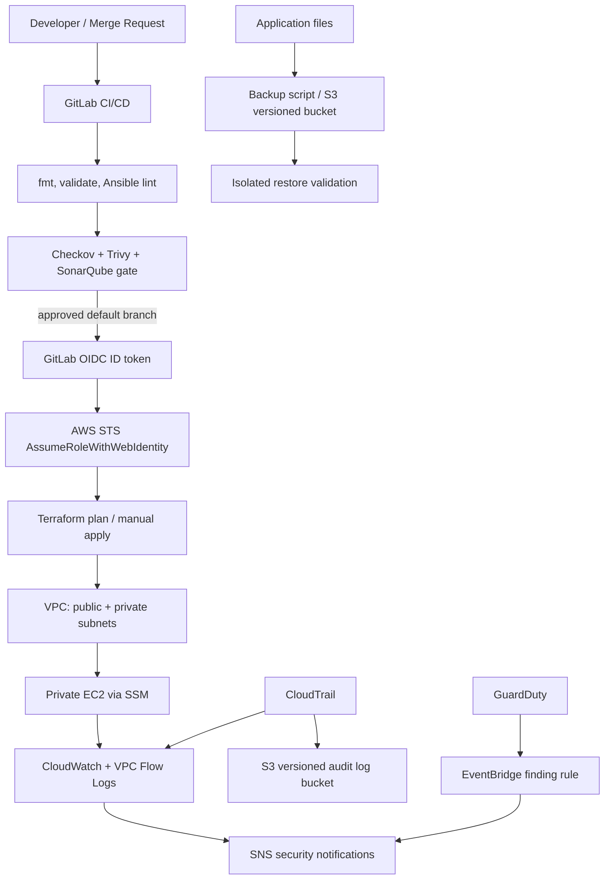

# Architecture and security design

## Logical flow

## Network boundaries

- EC2 has no public IP and no inbound SSH rule. Use SSM Session Manager and a private management path.
- Public subnets are reserved for future public-facing ingress components; the current sample does not deploy a load balancer.
- Private subnets use NAT for outbound access when enabled. NAT gateways have hourly/data charges; disable only if required egress is supplied via VPC endpoints/proxy.
- The application security group allows TCP/8080 only from `allowed_app_cidr`. Restrict this CIDR to the actual trusted load balancer/application tier before production.
- VPC Flow Logs are written to CloudWatch Logs with configurable retention.

## Identity and secrets

- GitLab CI receives an OIDC ID token and exchanges it with STS. The role trust limits both audience and subject to one project and branch.
- No static AWS access keys should be created for CI.
- Runtime secrets must be stored in Secrets Manager or SSM Parameter Store SecureString, with KMS and resource-level IAM policies. Do not place secret values in Terraform variables/state or pipeline logs. Add a dedicated secret module/policy for the actual application.
- The GitLab role policy in this starter grants state access and discovery reads only. It is **not sufficient to apply every root resource**; attach a reviewed, environment-specific least-privilege provisioning policy after resource inventory and permission testing. Do not solve failures by granting `AdministratorAccess`.

## Audit and detection

- Multi-region CloudTrail with log-file validation writes to a private, versioned S3 bucket and CloudWatch Logs.
- GuardDuty detector emits findings through EventBridge to SNS. Confirm SNS subscriptions and test notifications.
- CloudWatch alarms cover EC2 CPU and route alarms to SNS. Add workload health, disk, status-check, deployment, and backup-failure alarms for the real application.
- For regulated/production systems, use a separate log-archive account, customer-managed KMS key, restrictive bucket policy, Object Lock where required, and independent retention controls.

## Known scope boundaries

This baseline provisions one region, one private EC2 node, and networking/audit services. It is not an HA application design or multi-region DR solution. A production deployment needs a workload-specific load balancer, autoscaling or orchestration, data-tier backup, replicated recovery artifacts, DNS/failover, and tested regional recovery.
